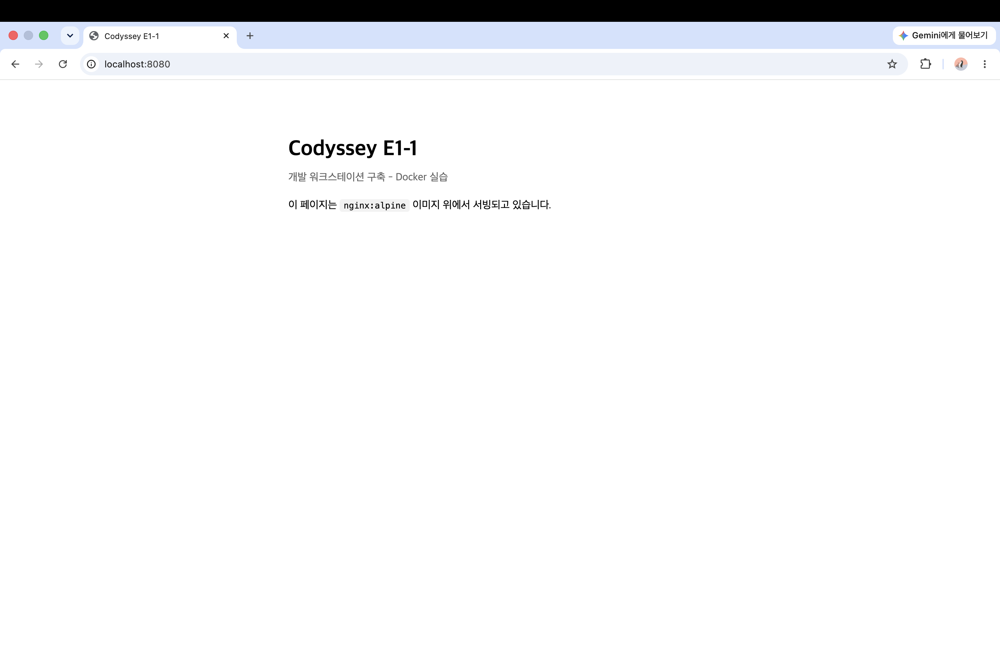
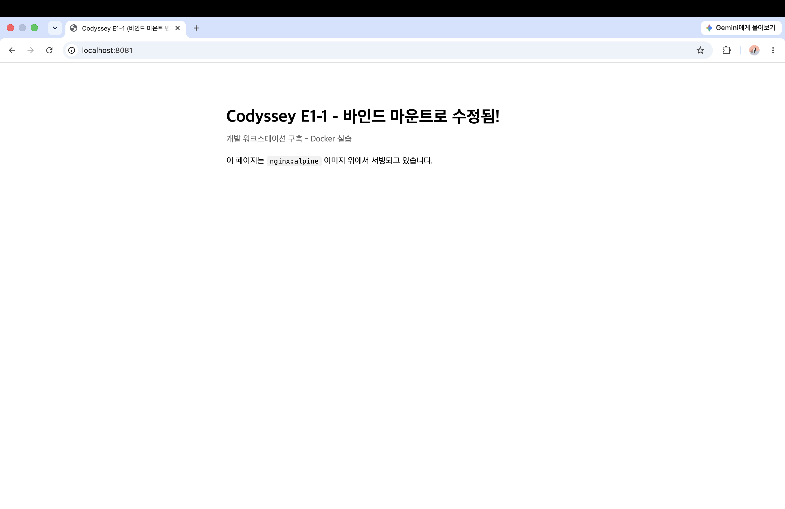
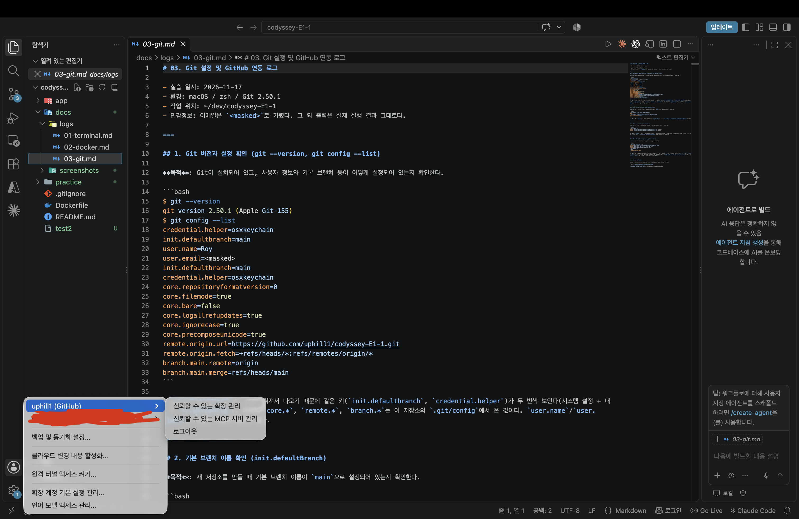
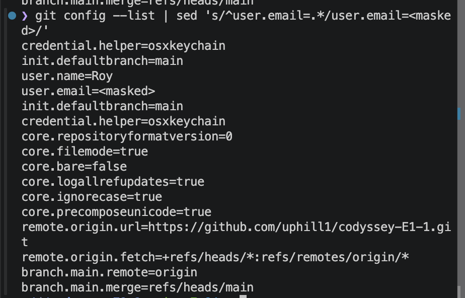

# Codyssey E1-1 - 개발 워크스테이션 구축

터미널, 권한, Docker, Git/GitHub로 개발 환경을 직접 구축하고, 한 일을 실제 명령 출력과 함께 기록한 저장소다.

## 1. 프로젝트 개요

| 영역 | 한 일 | 상세 로그 |
|---|---|---|
| 터미널/권한 | 파일·폴더 조작, 절대/상대 경로, `chmod`로 권한 변경 | [01-terminal.md](docs/logs/01-terminal.md) |
| Docker | 이미지/컨테이너 운영, Dockerfile 빌드, 포트 매핑, 바인드 마운트, 볼륨 | [02-docker.md](docs/logs/02-docker.md) |
| Git/GitHub | 설정 확인, 원격 저장소 연결 확인, 의미 단위 커밋 | [03-git.md](docs/logs/03-git.md) |

## 2. 실행 환경

| 항목 | 버전 |
|---|---|
| OS | macOS 26.3.1 (Apple Silicon, arm64) |
| 쉘 | zsh 5.9 |
| Docker Desktop | 4.90.0 (Docker Engine 29.7.2) |
| Git | 2.50.1 (Apple Git-155) |

> 대전 환경이라 sudo 제한이 없어 OrbStack 대신 Docker Desktop 사용

## 3. 디렉토리 구성

```text
codyssey-E1-1/
├── README.md              # 이 문서 (개요, 요약, 재현 절차, 트러블슈팅, 개념)
├── Dockerfile             # nginx:alpine 기반 커스텀 이미지 정의
├── .gitignore             # 비밀값/불필요 파일 제외 (.env, *.pem, *.key, .DS_Store)
├── app/
│   └── index.html         # 컨테이너가 서빙하는 정적 웹 페이지
└── docs/
    ├── logs/              # 실습 기록 (실제 명령과 출력)
    │   ├── 01-terminal.md
    │   ├── 02-docker.md
    │   └── 03-git.md
    └── screenshots/       # 브라우저/화면 캡처
```

**구성 기준**: "실행되는 것", "설명하는 것", "증거"를 나눴다.

| 위치 | 역할 |
|---|---|
| `app/` | 실행되는 결과물. Dockerfile이 `COPY`하는 대상이고, 바인드 마운트 실습에서는 호스트 폴더로 직접 연결된다 |
| `Dockerfile` | 이미지 빌드 설명서. 빌드 컨텍스트(`.`)의 기준이 되도록 저장소 루트에 둔다 |
| `docs/logs/` | 영역별 실습 로그. 명령 → 실제 출력 → 관찰 순서로 적는다 |
| `docs/screenshots/` | 결과 화면 증거 이미지 |

`practice/`(터미널 연습용 폴더)와 `test2`(연습용 빈 파일)는 로컬 연습 흔적이라 커밋하지 않는다.

## 4. 수행 항목 체크리스트

- [x] 터미널 조작: `pwd`, `ls -a`, `mkdir -p`, `touch`, `mv`, `cp`, `cat`, `rm`, `cd`
- [x] 절대 경로 / 상대 경로 이동 확인
- [x] 권한 실습: 파일(`chmod 600/000/644`), 디렉토리(`chmod 644/755`)
- [x] Docker 설치/점검 (`docker --version`, `docker info`)
- [x] 이미지/컨테이너 운영 명령 (`images`, `ps`, `ps -a`, `logs`, `stats`, `exec`)
- [x] 컨테이너 실행 (hello-world, ubuntu, `run -d`)
- [x] attach vs exec 차이 정리 (attach는 실행하지 않고 설명으로 기록)
- [x] Dockerfile 작성 + 이미지 빌드 + 포트 매핑 (`-p 8080:80`)
- [x] 포트 충돌 재현 → `lsof` 진단 → 해결
- [x] 바인드 마운트 (변경이 재시작 없이 반영되는지 확인)
- [x] Docker 볼륨 (컨테이너 삭제 후 데이터 유지 확인)
- [x] Git 설정/원격/로그/브랜치 확인
- [x] 스크린샷 3장: `port-mapping.png`, `bind-mount-before.png`, `bind-mount-after.png`
- [x] 스크린샷: `github-vscode.png` (GitHub/VS Code 연동 화면, 다른 계정 정보는 가림)
- [x] 스크린샷: `git-config.png` (`git config --list` 출력, 이메일 마스킹)

## 5. 수행 내용 요약

전체 출력은 [docs/logs/](docs/logs/)에 있다.

### 5-1. 터미널 / 권한 ([01-terminal.md](docs/logs/01-terminal.md))

```bash
$ mkdir -p docs/logs
$ mv docs/logs/01.terminal.md docs/logs/01-terminal.md
$ chmod 000 a.txt
$ cat a.txt
cat: a.txt: Permission denied
```

- 관찰: `mv`는 같은 폴더에서 쓰면 이름 변경이다. 권한을 `000`으로 만들면 소유자도 파일을 읽을 수 없다.

### 5-2. Docker 기본 운영 ([02-docker.md](docs/logs/02-docker.md))

```bash
$ docker run -d --name my-sleep ubuntu sleep 600
$ docker exec my-sleep echo hi
hi
$ docker ps
```

- 관찰: 컨테이너는 메인 프로세스가 살아 있는 동안만 `Up`이다. `exec`는 새 프로세스를 추가할 뿐이라 컨테이너에 영향이 없다.

### 5-3. Dockerfile 빌드와 포트 매핑

```bash
$ docker build -t codyssey-e1-1:1.0 .
$ docker run -d --name my-web -p 8080:80 codyssey-e1-1:1.0
$ curl -i http://localhost:8080
HTTP/1.1 200 OK
Server: nginx/1.31.8
```

- 관찰: `0.0.0.0:8080->80/tcp`는 "내 맥의 8080번으로 온 요청을 컨테이너 80번 포트로 전달한다"는 뜻이다. `HEALTHCHECK` 덕분에 `docker ps`에 `(healthy)`가 표시됐다.

### 5-4. 바인드 마운트

```bash
$ docker run -d --name my-bind -p 8081:80 -v "$(pwd)/app:/usr/share/nginx/html" nginx:alpine
$ curl -s http://localhost:8081 | grep "<h1>"      # 수정 후
  <h1>Codyssey E1-1 - 바인드 마운트로 수정됨!</h1>
```

- 관찰: 호스트의 `app/index.html`만 고쳤는데 컨테이너를 재시작하지 않고도 바로 바뀌었다. `COPY`로 이미지에 넣은 `my-web`(8080)은 그대로였다.

### 5-5. 볼륨

```bash
$ docker volume create my-data
$ docker run --name my-vol1 -v my-data:/data ubuntu bash -c 'echo persist-test > /data/test.txt'
$ docker rm my-vol1
$ docker run --name my-vol2 -v my-data:/data ubuntu cat /data/test.txt
persist-test
```

- 관찰: 컨테이너를 지워도 볼륨과 파일은 남았고, 새 컨테이너가 같은 내용을 읽었다.

### 5-6. Git ([03-git.md](docs/logs/03-git.md))

```bash
$ git remote -v
origin	https://github.com/uphill1/codyssey-E1-1.git (fetch)
origin	https://github.com/uphill1/codyssey-E1-1.git (push)
$ git branch -a
* main
  remotes/origin/main
```

- 관찰: 로컬 `main`이 GitHub의 `origin/main`과 연결되어 있다. 설정 출력에서 이메일은 마스킹했다.

## 6. 재현 절차

처음부터 따라 하는 순서다. 저장소 루트에서 실행한다. (이름이 `my-`로 시작하는 리소스만 만들고 지운다.)

```bash
# 0) 저장소 받기
git clone https://github.com/uphill1/codyssey-E1-1.git
cd codyssey-E1-1

# 1) Docker 동작 확인
docker --version
docker info
docker run hello-world

# 2) 이미지 빌드 + 8080 포트로 실행
docker build -t codyssey-e1-1:1.0 .
docker run -d --name my-web -p 8080:80 codyssey-e1-1:1.0
docker ps
curl -i http://localhost:8080            # 브라우저: http://localhost:8080

# 3) 포트 충돌 재현과 해결
docker run -d --name my-web2 -p 8080:80 codyssey-e1-1:1.0   # 에러: port is already allocated
lsof -nP -iTCP:8080 -sTCP:LISTEN                            # 누가 쓰는지 확인
docker run -d --name my-web3 -p 8082:80 codyssey-e1-1:1.0   # 호스트 포트만 바꿔 해결

# 4) 바인드 마운트 (8081)
docker run -d --name my-bind -p 8081:80 -v "$(pwd)/app:/usr/share/nginx/html" nginx:alpine
curl http://localhost:8081
# app/index.html의 제목을 수정한 뒤 컨테이너 재시작 없이 다시 확인
curl http://localhost:8081

# 5) 볼륨
docker volume create my-data
docker run --name my-vol1 -v my-data:/data ubuntu bash -c 'echo persist-test > /data/test.txt'
docker rm my-vol1
docker run --name my-vol2 -v my-data:/data ubuntu cat /data/test.txt
docker volume ls
docker volume inspect my-data

# 6) 정리 (내가 만든 my-* 만, 목록을 확인한 뒤 삭제)
docker ps -a --filter 'name=^my-'
docker rm -f my-web my-web2 my-web3 my-bind my-vol2
docker volume rm my-data
docker ps -a
docker volume ls
```

## 7. 트러블슈팅

| # | 문제 | 원인 가설 | 확인 | 해결 |
|---|---|---|---|---|
| 1 | `docker: Error response from daemon: ... Bind for 0.0.0.0:8080 failed: port is already allocated` | 호스트 8080 포트를 이미 다른 컨테이너(`my-web`)가 쓰고 있다 | `lsof -nP -iTCP:8080 -sTCP:LISTEN`로 Docker가 점유 중인 것을 확인, `docker port my-web`로 어느 컨테이너인지 확인 | 호스트 포트만 바꿔 `-p 8082:80`으로 실행. 실패한 `my-web2`는 `Created` 상태로 남으므로 `docker rm`으로 정리 |
| 2 | `zsh: command not found: run` | `run`은 쉘 명령이 아니라 `docker`의 하위 명령인데 `docker`를 빠뜨렸다 | 에러 메시지가 "쉘이 `run`이라는 프로그램을 못 찾았다"는 뜻임을 확인 | `docker run hello-world`처럼 `docker`를 앞에 붙인다 |
| 3 | `docker attach` 중 Ctrl+C를 눌렀더니 컨테이너가 `Exited` | attach는 메인 프로세스(PID 1)에 직접 연결되어, Ctrl+C(SIGINT)가 메인 프로세스(`sleep`)를 종료시켰다 | `docker ps -a`에서 해당 컨테이너가 `Exited`인 것을 확인 | `docker attach --sig-proxy=false 컨테이너이름`으로 시그널 전달을 막거나, 애초에 `docker exec`를 쓴다 |
| 4 | 디렉토리에서 `x` 권한을 빼자 `cd practice` 실패 (`cd: permission denied: practice`), `ls practice`도 실패 | 디렉토리의 `x`는 "안으로 들어갈 수 있는 권한"인데 `chmod 644`로 `x`를 없앴다 | `ls -ld practice`에서 `drw-r--r--`(x 없음) 확인 | `chmod 755 practice`로 복구해 `drwxr-xr-x`로 돌아옴 |
| 5 | `git add`에서 `pathspec ... did not match any files` | `git add` 경로는 **현재 위치 기준**이라, 저장소 루트가 아닌 폴더(예: `practice/`)에서 루트 기준 경로를 썼다 | `pwd`와 `git status`로 현재 위치와 파일의 상대 위치 확인 | 저장소 루트로 이동해 경로를 쓰거나, 현재 위치 기준 경로로 바꿔서 입력한다 |

> 5번은 터미널 실습 중 겪은 일을 정리한 것이라 별도 출력 로그는 남기지 않았다.

## 8. 개념 정리

### 절대 경로와 상대 경로

절대 경로는 `/`나 `~`부터 시작해서 어느 위치에서 써도 같은 곳을 가리킨다(예: `cd ~/dev/codyssey-E1-1`). 상대 경로는 **지금 있는 위치**를 기준으로 하기 때문에 위치가 다르면 같은 명령이 실패한다. 예를 들어 `cd practice`는 저장소 루트에서는 되지만 다른 폴더에서는 `no such file or directory`가 난다. 같은 이유로 `git add`에 쓰는 경로가 틀려도 pathspec 에러가 난다.

### 권한 r / w / x 와 755 / 644

`r`(읽기)=4, `w`(쓰기)=2, `x`(실행)=1이고, 소유자 / 그룹 / 기타 순서로 세 자리를 쓴다. `644`는 `rw-r--r--`로 소유자는 읽고 쓰고 나머지는 읽기만 되는 일반 파일의 기본 권한이고, `755`는 `rwxr-xr-x`로 실행 파일이나 디렉토리의 기본 권한이다. 디렉토리의 `x`는 "안으로 들어갈 수 있는 권한"이라서 빼면 `cd`와 `ls`가 막힌다.

### 이미지와 컨테이너

이미지는 읽기 전용 설계도이고, 컨테이너는 그 설계도로 만든 실행 인스턴스다. 이번 실습에서 `codyssey-e1-1:1.0` 이미지 하나로 `my-web`(8080)과 `my-web3`(8082) 두 컨테이너를 동시에 띄웠다. 컨테이너를 `docker rm`으로 지워도 이미지는 그대로 남아 있어서(`docker images`로 확인) 언제든 새 컨테이너를 만들 수 있다.

### 포트 매핑이 필요한 이유

컨테이너는 자기만의 독립된 네트워크 공간(네트워크 네임스페이스)을 가져서, 컨테이너 안의 80번 포트는 기본적으로 호스트(내 맥)에서 바로 접근할 수 없다. `-p 8080:80`을 쓰면 Docker가 호스트의 8080 포트로 들어온 요청을 컨테이너의 80번 포트로 전달(포트 포워딩)해 준다. 컨테이너 안의 포트는 컨테이너마다 독립이라 겹쳐도 되지만, 호스트의 포트는 하나뿐이라 같은 호스트 포트를 두 번 쓰면 `port is already allocated` 에러가 난다.

### 볼륨과 바인드 마운트, 데이터 손실 방지

바인드 마운트는 **호스트의 특정 폴더**(`-v "$(pwd)/app:/usr/share/nginx/html"`)를 컨테이너에 직접 연결하는 것이라 호스트에서 고치면 컨테이너에 바로 반영된다(소스 코드 개발에 편하다). 볼륨(`-v my-data:/data`)은 **Docker가 관리하는 저장 공간**이라 컨테이너를 지워도 데이터가 남고, 호스트 경로를 신경 쓰지 않아도 된다(DB 같은 데이터 보관에 적합). 단, 컨테이너 안에만 쓴 데이터는 컨테이너를 지우면 사라지고, 볼륨도 `docker volume rm` 하면 사라진다.

간단한 백업 절차(볼륨 `my-data`를 현재 폴더의 tar 파일로 보관하는 예):

```bash
docker run --rm -v my-data:/data -v "$(pwd)":/backup ubuntu tar czf /backup/my-data-backup.tar.gz -C /data .
```

복원은 반대로 `tar xzf`로 새 볼륨에 풀어 넣는다. 백업 파일에 민감한 데이터가 들어갈 수 있으니 저장소에 커밋하지 않는다.

### Git과 GitHub

Git은 내 컴퓨터에서 변경 이력을 관리하는 도구(버전 관리 시스템)이고, GitHub는 그 저장소를 인터넷에 올려 두고 공유·협업하는 서비스다. `git commit`은 내 컴퓨터(로컬)에만 기록되고, `git push`를 해야 GitHub(`origin`)에 올라간다. Git만으로도 이력 관리는 되지만, GitHub가 있으면 백업과 공유가 된다.

## 9. 스크린샷

| 항목 | 파일 |
|---|---|
| 포트 매핑 (`http://localhost:8080`) | `docs/screenshots/port-mapping.png` |
| 바인드 마운트 변경 전 (`http://localhost:8081`) | `docs/screenshots/bind-mount-before.png` |
| 바인드 마운트 변경 후 (`http://localhost:8081`) | `docs/screenshots/bind-mount-after.png` |
| GitHub / VS Code 연동 | `docs/screenshots/github-vscode.png` |
| Git 설정 (`git config --list`, 이메일 마스킹) | `docs/screenshots/git-config.png` |

**포트 매핑**



**바인드 마운트 - 변경 전**


**바인드 마운트 - 변경 후**



**GitHub / VS Code 연동**



**Git 설정 (이메일 마스킹)**



## 10. 보안 점검 체크리스트

- [x] 로그/문서/코드에 토큰, 비밀번호, API 키가 없다 (커밋 전 `grep`으로 확인)
- [x] 이메일 주소를 기록하지 않았다 (`git config --list`의 `user.email`은 `<masked>`)
- [x] 스크린샷에도 이메일이 보이지 않는다 (`git-config.png`는 `sed`로 마스킹, `github-vscode.png`는 계정 메뉴의 다른 계정 정보를 칠로 가림. 커밋 전에 이미지를 직접 열어 확인)
- [x] `.gitignore`에 `.env`, `*.pem`, `*.key`, `.DS_Store`를 넣었다
- [x] 원격 주소(`remote.origin.url`)에 인증 정보가 들어 있지 않다 (HTTPS 주소만 사용, 인증은 macOS 키체인)
- [x] `git add .` 없이 파일을 하나씩 지정해서 추가했다
- [x] 연습용 `practice/`, `test2`는 커밋하지 않았다
- [x] 이름/학번 등 개인 식별 정보를 웹 페이지(`app/index.html`)에 넣지 않았다
- [x] 기존 Docker 리소스는 건드리지 않고 `my-` 접두사 리소스만 만들고 지웠다
