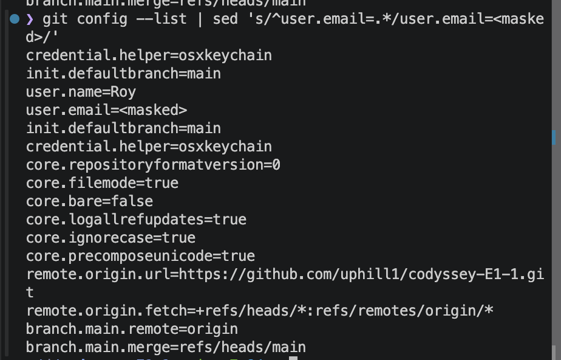
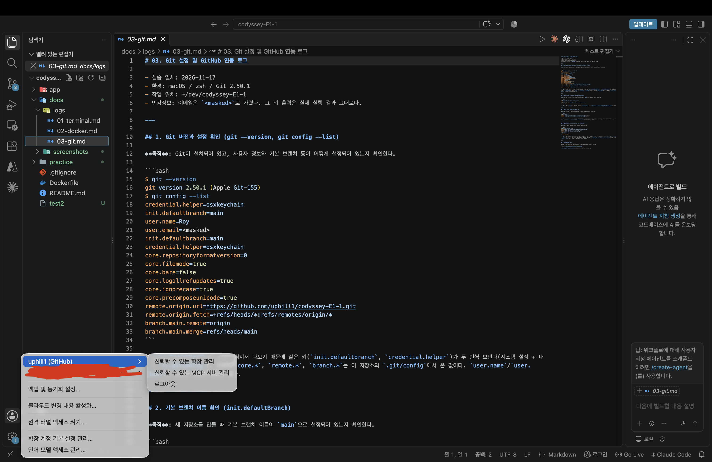

# 03. Git 설정 및 GitHub 연동 로그

- 실습 일시: 2026-11-17
- 환경: macOS / zsh / Git 2.50.1
- 작업 위치: ~/dev/codyssey-E1-1
- 민감정보: 이메일은 `<masked>`로 가렸다. 그 외 출력은 실제 실행 결과 그대로다.

---

## 1. Git 버전과 설정 확인 (git --version, git config --list)

**목적**: Git이 설치되어 있고, 사용자 정보와 기본 브랜치 등이 어떻게 설정되어 있는지 확인한다.

```bash
$ git --version
git version 2.50.1 (Apple Git-155)
$ git config --list
credential.helper=osxkeychain
init.defaultbranch=main
user.name=Roy
user.email=<masked>
init.defaultbranch=main
credential.helper=osxkeychain
core.repositoryformatversion=0
core.filemode=true
core.bare=false
core.logallrefupdates=true
core.ignorecase=true
core.precomposeunicode=true
remote.origin.url=https://github.com/uphill1/codyssey-E1-1.git
remote.origin.fetch=+refs/heads/*:refs/remotes/origin/*
branch.main.remote=origin
branch.main.merge=refs/heads/main
```

**관찰**: 설정은 여러 파일에서 합쳐져서 나오기 때문에 같은 키(`init.defaultbranch`, `credential.helper`)가 두 번씩 보인다(시스템 설정 + 내 홈의 `~/.gitconfig`). 아래쪽 `core.*`, `remote.*`, `branch.*`는 이 저장소의 `.git/config`에서 온 값이다. `user.name`/`user.email`은 커밋의 작성자 정보가 된다.

아래 스크린샷은 이메일이 화면에 나오지 않도록 `git config --list | sed 's/^user.email=.*/user.email=<masked>/'`로 가려서 찍은 것이다.



---

## 2. 기본 브랜치 이름 확인 (init.defaultBranch)

**목적**: 새 저장소를 만들 때 기본 브랜치 이름이 `main`으로 설정되어 있는지 확인한다.

```bash
$ git config --get init.defaultBranch
main
$ git config --show-origin --get init.defaultBranch
file:~/.gitconfig	main
```

**관찰**: 이미 `main`으로 설정되어 있어서(`~/.gitconfig`) 따로 `git config --global init.defaultBranch main`을 실행하지 않았다.

---

## 3. 원격 저장소 확인 (git remote -v)

**목적**: 이 로컬 저장소가 어떤 GitHub 저장소와 연결되어 있는지 확인한다.

```bash
$ git remote -v
origin	https://github.com/uphill1/codyssey-E1-1.git (fetch)
origin	https://github.com/uphill1/codyssey-E1-1.git (push)
```

**관찰**: `origin`은 원격 저장소에 붙인 이름이고, 가져오기(fetch)와 올리기(push) 주소가 같다. HTTPS 주소이고 주소 안에 토큰이나 비밀번호는 들어 있지 않다. 인증은 `credential.helper=osxkeychain`이 맥 키체인으로 처리한다.

---

## 4. 커밋 기록과 브랜치 (git log, git branch -a)

**목적**: 지금까지의 커밋 이력과 브랜치 구성을 확인한다.

```bash
$ git log --oneline -n 10
885090d docs: add file ops and permission practice logs
bbb19d7 echo, cat, cp, rm,절대경로, 상대경로
918094a docs: add terminal practice log
$ git branch -a
* main
  remotes/origin/main
```

**관찰**: 이 시점에는 커밋이 3개라서 10개를 요청했지만 3개만 나왔다. `*`는 지금 있는 브랜치(`main`)를 뜻하고, `remotes/origin/main`은 GitHub 쪽 `main` 브랜치를 로컬이 기억해 둔 사본이다. 두 번째 커밋 메시지(`echo, cat, cp, rm,절대경로, 상대경로`)는 형식 없이 쓴 것이라, 이후 커밋부터는 `docs:`, `feat:` 같은 접두사를 붙여 의미 단위로 나눈다.

---

## 5. GitHub 연동 화면

VS Code에서 GitHub 계정(`uphill1`)으로 로그인되어 있고, 이 저장소(`codyssey-e1-1`)를 열어 `docs/logs/03-git.md`를 편집하는 화면이다.

- 파일: `docs/screenshots/github-vscode.png`
- 계정 메뉴에 함께 보이던 다른 계정 정보는 붉은 칠로 가렸다.


